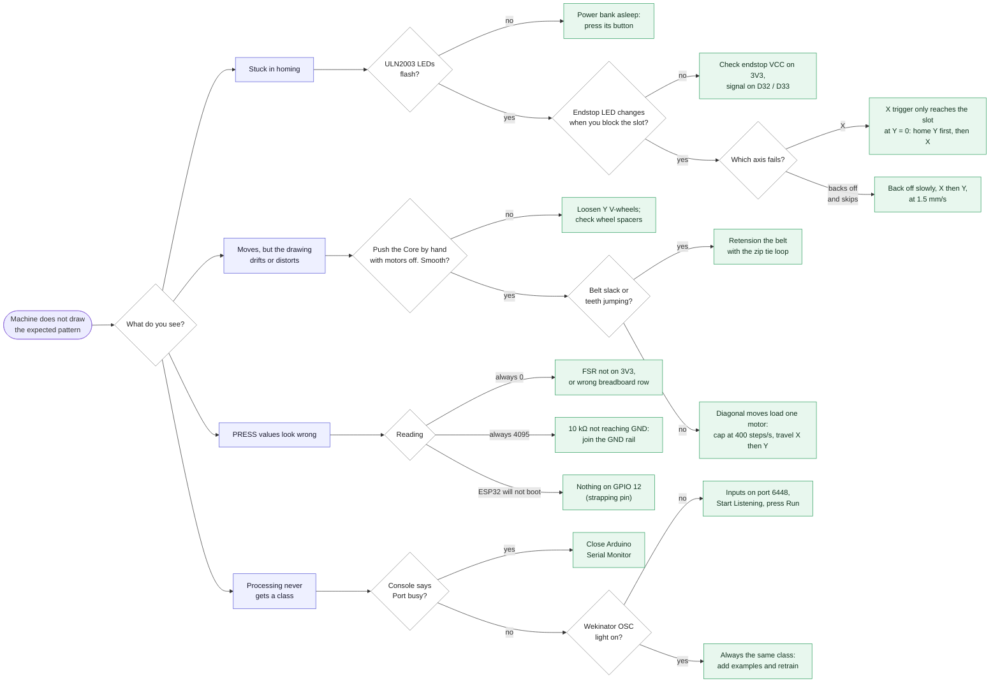

## Debugging

Start from what you see, follow the questions, and stop at the first green box that matches. Every fix below is a problem we hit during the build and test sessions.



(Static copy for slides: `debug/debug_map.png`.)

### Main case: homing

Homing was the hardest problem because three separate faults looked the same from outside: the machine started homing and never printed `ok`.

| Step | What we saw | Cause | Fix |
|---|---|---|---|
| 1 | Nothing moved, ULN2003 LEDs dark | The 5 V power bank switches off when the current draw is low | Press the power bank button before each run; idle coils are off, so it can fall asleep again between demos |
| 2 | Y homed, then X ran into the side wall | The X trigger is a short belt piece on the Core. It only passes through the X endstop slot when Y is at its minimum | Home Y first, then X, as in the ZenXY docs. Limit each seek to the drawing size + 20 mm and print `error: X endstop not found` instead of grinding |
| 3 | Both endstops found, then the motors buzzed and lost position on the back-off | The Core is pressed into the corner and the motors were just running the other way. A full-speed reverse start makes the 28BYJ-48 skip | Wait 200 ms, then back off at 1.5 mm/s, X first, then Y |

How we isolated it: we sent `H` on its own from the Serial Monitor and blocked each endstop slot by hand to check that its LED changed, so we knew the sensor worked before changing the code.

```cpp
bool okY = seek(ENDSTOP_Y, -1, +1, Y_MAX + 20);   // Y first
bool okX = seek(ENDSTOP_X, -1, -1, X_MAX + 20);   // pure X move, Y stays at 0
delay(200);
speedMM = 1.5;                                      // slow back-off
moveTo(BACKOFF_MM, 0);
moveTo(BACKOFF_MM, BACKOFF_MM);
```

### Other issues we fixed

| Area | Symptom | Cause | Fix |
|---|---|---|---|
| Motion | Lines bent on 45-degree moves | A diagonal move drives only one motor, at about 1.4 times the rate of a straight move; it skipped above 450 half-steps/s | Cap each motor at 400 half-steps/s; Processing travels X then Y between patterns |
| Mechanics | Core stuck at points on the Y rails | Y V-wheels set too tight | Loosened the wheels until the Core slid freely by hand with the motors off |
| Mechanics | Shapes stretched and offsets crept in | Belt slack let teeth jump on the pulley | Retensioned with the zip tie loop on the Core |
| Sensing | FSR readings stuck at 4095 | The breadboard GND rail was not joined, so the 10 kΩ resistors had no ground | Linked the GND rails to the ESP32 GND |
| Sensing | ESP32 sometimes did not boot | GPIO 12 is a strapping pin; a pressed FSR at reset changed the boot mode | Moved that sensor off GPIO 12 |
| Software | Processing: `Port busy` | The Arduino Serial Monitor still held the port | Close the Serial Monitor before running Processing |
